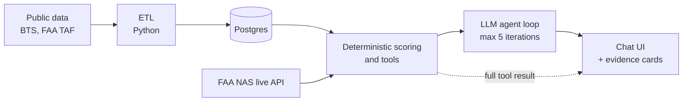

# Design: Airport Investment Intelligence Agent

## 1. Goal and scope
A chat agent that helps an analyst judge which of **16 US airports** (6 New England, 8 California, ANC, FAI) are the best candidates for terminal expansion. It answers four questions: New England expansion candidates, LAX vs SNA congestion, ANC long-haul share, SFO unmet demand and why. It is a screening tool built on public data. It does not know gates, terminal size, capex, or revenue, so it cannot say what an expansion would earn.

## 2. Architecture

- ETL cleans the raw files into `data/clean/*.csv`; `npm run seed` loads them into Postgres.
- Six tools (`rankAirports`, `compareAirports`, `getAirportProfile`, `getRouteMix`, `getUnmetDemand`, `getLiveAirportStatus`) compute everything. Each returns data, sources, assumptions and flags.
- The agent loop sends the question and tool specs to the LLM, runs the tool calls it asks for (zod-validated), and repeats.
- The model sees a compacted tool result. The UI gets the full result and renders it as evidence cards beside the chat.

## 3. Data
| Source | Used for |
|---|---|
| BTS T-100 Segment | seats, passengers, load factor, departures, distance, freight class |
| BTS On-Time Performance | NAS-attributed delay, delayed-15+ share |
| BTS Average Domestic Fares | fare vs peer median |
| FAA TAF 2025 | enplanement forecast (growth) |
| OurAirports | runway counts |
| FAA NAS Status (live API) | current ground stops, delays, closures |

Bulk files are loaded once so the demo is reproducible and works offline; the data does not change between runs. The one live API is used only for "what is happening now", because the NAS API has no history. Scoring window: **trailing 12 months 2025-07 to 2026-06**, compared with a 2019 baseline. 2026 is partial in every monthly source. TAF growth uses FY2025 to FY2030.

## 4. Scoring methodology
Five components, each min-max scaled to 0-100 across **all 16 airports**, then weighted:

| Component | Weight | Raw metric (higher = more expansion pressure) |
|---|---|---|
| Utilization | 30% | 12-month load factor (T-100) |
| Growth | 25% | 50/50 blend of recovery (12-month pax / 2019 pax) and TAF enplanement CAGR FY2025-FY2030 |
| Congestion | 20% | share of arriving flights with a NAS delay (reporting carriers only) |
| Pricing power | 15% | mean fare / 16-airport median fare, latest 4 quarters |
| Scale | 10% | ln(12-month passengers) |

- Min-max is `(x - min) / (max - min) x 100`. Size uses `ln(pax)` so LAX does not flatten every other airport.
- **Congestion is null** if On-Time covers less than 50% of an airport's T-100 departures (only FAI). Missing components are dropped and the remaining weights re-normalized; the result carries a confidence level.
- Scores are always computed against all 16. A region filter only chooses which rows are displayed (rank in scope plus overall rank), so a score never changes with the question.
- Ties break on passengers, then IATA code. Same input, same output.

**Worked example, New England:** BOS 71.9 vs BTV 70.8. Contributions (points):

| | Util | Growth | Cong | Price | Scale | Total |
|---|---|---|---|---|---|---|
| BOS | 27.69 | 16.50 | 14.78 | 4.23 | 8.68 | 71.9 |
| BTV | 28.97 | 19.19 | 9.26 | 12.89 | 0.52 | 70.8 |

BTV wins on load factor, growth and fares; BOS wins on congestion and size. Full order: BOS 71.9, BTV 70.8, PWM 61.4, BDL 54.6, PVD 47.6, MHT 33.9. The score says which airport is under the most pressure for its size, not which is the biggest prize.

## 5. Key tradeoffs
| Decision | Chosen | Why / cost |
|---|---|---|
| Min-max vs percentile rank | Min-max (percentile kept as a config option) | Percentile turned a 0.813 vs 0.818 load-factor gap into 40 vs 100 and ranked BTV 77.1 above BOS 68.4. Min-max keeps small gaps small. Cost: outliers stretch the scale. |
| One ranking or two | Two views: "most pressured" (score) and "biggest absolute opportunity" (unmet seats, 12-month pax) | The views disagree. BOS has 398,907 unmet seats, BTV 14,587. One number would hide that. |
| Unmet demand definition | seats x max(0, LF - 0.85) per route-month, summed | Observed turned-away demand is not public. 85% is a judgment threshold, not a measured one. |
| Bulk data vs live API | Bulk datasets plus one live API | Reproducible and offline-capable; the live API has no history, so it only covers current state. Cost: data is a snapshot. |
| Model / provider | Groq free tier (8,000 tokens/min), mock provider for tests | Free and fast, but a ranking result of about 7,400 tokens hit the cap. Fixed by compacting model payloads (about 1,986 tokens for all 16). Cost: the model sees less detail than the UI. |
| Checking the LLM | Lexical grounding check in the E2E runner | Cheap and catches invented numbers. Cost: it proves a number exists in tool output, not that it is attached to the right metric. |

## 6. Where AI is used, and where not
**LLM:** picks which tool to call, explains the result in plain language, and handles follow-ups ("why is BTV above BDL?"). It runs inside a 5-iteration tool loop, then gives a final tool-less answer.

**Not LLM:** every number, score, rank, share and flag. Scoring is plain TypeScript with no I/O (78 unit tests pass).

**Guardrails** (system prompt plus checks):
- Every number must appear in a tool result from the conversation; if no tool provides it, the model says so.
- Methodology is only restated from the tool's methodology, normalization, weights and window fields.
- Flags are structured (code, severity, message) and the model mentions only those that affect the conclusion.
- The E2E runner checks that every number in an answer exists in a tool result or argument. All 4 questions pass (see [e2e-results.md](e2e-results.md)).
- The UI shows a quiet usage line (token usage and the Groq rate-limit meter) so a 413 is not a mystery.

## 7. Assumptions and uncertainty
- **Unmet demand is a proxy**: passengers above an 85% load-factor comfort threshold, not observed turned-away demand. Route-months with fewer than 10 departures are ignored. The "why" for SFO is inference.
- **No New England airport reaches 0.85 load factor** (highest is BTV at 0.818), so annual airport-level unmet demand is 0 there. The route-month figure is the headline because averaging hides peaks. SFO shows this: 556,759 unmet seats by route-month, but 0 at annual level (load factor 0.8227).
- **2026 is partial**, so growth and the window mix full and partial data.
- **Remote-airport fares:** high BTV and FAI fares partly reflect remoteness, so pricing power overstates their market power. The fare benchmark is used for scoring and explanation only.
- **Delay data covers reporting carriers only.** FAI congestion is null (coverage below 50%); ANC sits just above the cutoff (50.2%); BOS, BTV, MHT and LAX are moderate coverage (LAX about 75%).
- **ANC is cargo-heavy:** freighters are 56.5% of departures. Long-haul share is therefore always shown passenger-only and with cargo at 1,500 / 2,500 / 3,000 mi (2.8% vs 31.1% at 3,000 mi). The cutoff is a parameter, default 3,000 mi.
- **Small peer set (16):** scores are relative, not absolute. A score of 70 means "high among these 16".
- **Grounding check is lexical**, as noted above. I read each E2E answer against the tool output by hand.
- **Groq free tier:** back-to-back large questions can still hit the 8,000 tokens/min cap.

## 8. What I would do next
- Add more airports and a configurable peer set.
- Add route-level economics (fares by route, DB1B) instead of airport averages.
- Replace the load-factor proxy with real demand signals (booking or search data, capacity limits).
- Add voice input and a paid LLM tier to remove the rate-limit constraint.
